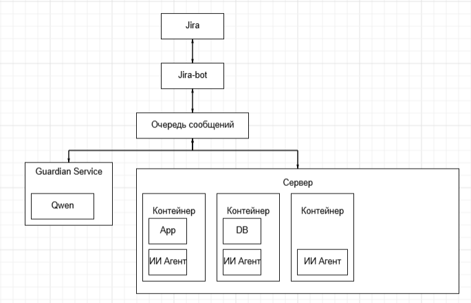
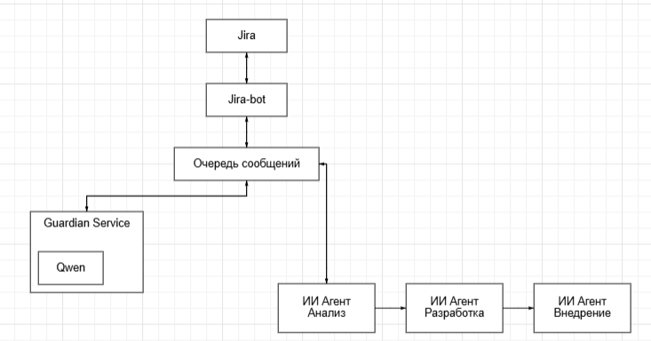
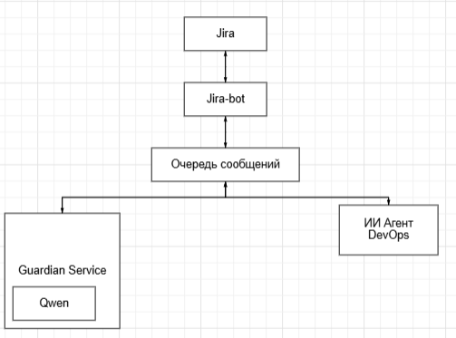

# multi-agent-executor

EN | [RU](README_ru.md)

[](https://hawkab.github.io/support/)

Optional contributions support development, maintenance and testing. The [support page](https://hawkab.github.io/support/) has a QR code, wallet link and copy buttons, and works on computers and phones. You choose the amount in your wallet.

Durable Jira-driven software delivery workflow with security gating, role reviews, deployment verification and crash recovery.

## Architecture

```text
User/Jira
   |
   v
jira-bot -------------------------------> Jira REST API
   |                         comments/status/assignment/subtasks/attachments
   v
Guardian (rules + LLM + human security review)
   |
   v
workflow-orchestrator <---- workflow.results ---- role workers
   |                                                |
   +--> analyst ------------------------------------+
   +--> analyst-reviewer ---------------------------+
   +--> developer (fullstack, 0-1 component) ----------+
   +--> backend-developer (parallel when selected) ----+
   +--> frontend-developer (parallel when selected) ---+
   +--> dba-developer (parallel when selected) --------+
   +--> developer-reviewer (one diff per review) ------+
   +--> devops (existing pikobot service) -------------+
   +--> tester -------------------------------------+
   |
   +--> jira.commands --> jira-bot
   |                       |
   |       workflow.external-events (confirmed Jira side effects)
   |
   +--> gitlab.commands --> GitLab adapter (deterministic E2E stub)
                           |
           workflow.external-events (trusted merge evidence)
   |
   +--> SQLite checkpoints + per-role JSONL worklogs

agent-hypervisor monitors durable leases and requeues or escalates expired work.
```

Guardian remains the mandatory security gate. `jira-bot` remains the only component that calls Jira. Role agents and the orchestrator communicate only through durable RabbitMQ messages.

## Workflow

1. A user assigns an unstructured Jira issue to the jira-bot account in `Сделать`.
2. jira-bot moves it to `В работе` and sends it to Guardian.
3. Guardian allows, requests clarification, blocks, or sends it to security review.
4. The orchestrator dispatches analyst -> analyst-reviewer review loops.
5. Only after analyst-reviewer approval, the specification is decomposed into Jira subtasks. Developer work is not dispatched until jira-bot confirms every creation operation.
6. Analyst classifies `backend`, `frontend`, and `database`. Zero or one component uses one fullstack `developer`. Two or three components require a frozen versioned global API contract and fan out in parallel only to the affected backend/frontend/DBA workers.
7. Every developer works through TDD, validates the same contract version when parallel, performs/fixes self-review, and creates/updates its internal GitLab MR.
8. Developer-reviewer reviews each implementation role separately. One approval never covers another role; rejected roles return through self-review and independent review again.
9. DevOps starts only after all required approvals, verifies cross-component contract/integration/migration checks, CI/CD and staging. For parallel work it must return the single integration MR; only that MR can enter tester/GitLab merge verification. Deployment failures return logs to the affected development roles.
10. A testing subtask receives `original-user-request.json`. Tester starts only after the matching Jira completion event supplies its issue key and validates only the original user request.
11. Obvious bugs return to the relevant developers. Ambiguous bugs go to analyst and, if needed, the user.
12. Tester output requests `gitlab.verify_merge`; it cannot close the workflow. A separate GitLab adapter returns matching project/MR/SHA, merge, pipeline and named reviewer/tester approval evidence. Stub terminal verification is fail-closed by default and is enabled only through explicit `ALLOW_STUB_TERMINAL_VERIFICATION=true` in isolated E2E.

## Durable state and recovery

- Checkpoint DB: Docker volume `workflow_state`, file `/state/workflow.sqlite3`.
- Per-role traces: `/state/worklogs/<role>/<issue>.jsonl`.
- Every agent result is also relayed by jira-bot to a Jira comment.
- RabbitMQ messages are persistent and queues are durable.
- Inbox event, workflow transition, worklog and outgoing commands are committed atomically in one SQLite transaction.
- Transactional outbox commands are replayed after reconnect/restart and use stable command IDs.
- Outbox rows are atomically claimed with an owner and expiring lease, preventing concurrent runtimes from publishing the same row.
- Domain side effects have higher outbox priority than audit comments, so a temporary Jira audit failure cannot block agent dispatch.
- Each dispatch has a fencing `dispatch_id`; stale role results and heartbeats cannot advance the workflow.
- Parallel specialist dispatches keep independent fencing tokens, leases, retry counters and per-role JSONL worklogs; hypervisor recovers each expired role independently.
- Jira/GitLab external operations also have durable payloads, stable operation IDs, leases and bounded hypervisor retries; exhaustion blocks and escalates instead of waiting forever.
- SQLite is the authoritative worklog. On orchestrator startup, per-role JSONL mirrors are atomically rebuilt from SQLite, recovering a crash between database commit and filesystem append.
- Agent dispatch, Jira assignment and Jira transition are separate outbox records, preventing partial-publish replay from duplicating agent work.
- Publishers use confirms and mandatory routing.
- jira-bot stores `pending/completed` command saga state and result JSON. It reconciles Jira operation labels, attachments, comments, transitions and assignments before reporting completion; poison/exhausted messages go to per-queue DLQs.
- Every stage change is recorded in SQLite and append-only JSONL and projected to Jira as a transition worklog.
- `agent-hypervisor` retries expired leases up to `WORKFLOW_MAX_ATTEMPTS`, then moves the workflow to blocked/escalation.
- Process/container restarts do not delete the checkpoint or worklogs.

## Configuration

Set these in `.env` or the deployment secret mechanism. Copy `.env.example` to
`.env` for local overrides. For an authenticated/custom worker endpoint, copy
`pikobot-config/config.json` to the ignored `pikobot-config/config.local.json`,
configure the private copy, and set `PIKOBOT_CONFIG_PATH` to that file. All role
workers mount the selected configuration; the versioned file stays a template.

```dotenv
AGENT_WORKSPACE_PATH=/absolute/path/to/target/repository
AGENT_BACKEND_WORKSPACE_PATH=/absolute/path/to/backend-worktree
AGENT_FRONTEND_WORKSPACE_PATH=/absolute/path/to/frontend-worktree
AGENT_DBA_WORKSPACE_PATH=/absolute/path/to/dba-worktree
JIRA_USERNAME=agent-orchestrator
JIRA_PASSWORD=...
JIRA_USER_ANALYST=agent-analyst
JIRA_USER_ANALYST_REVIEWER=agent-analyst-reviewer
JIRA_USER_DEVELOPER=agent-developer
JIRA_USER_BACKEND_DEVELOPER=agent-backend-developer
JIRA_USER_FRONTEND_DEVELOPER=agent-frontend-developer
JIRA_USER_DBA_DEVELOPER=agent-dba-developer
JIRA_USER_DEVELOPER_REVIEWER=agent-developer-reviewer
JIRA_USER_DEVOPS=agent-devops
JIRA_USER_TESTER=agent-tester
JIRA_DONE_STATUS_NAME=Готово
JIRA_SUBTASK_TYPE_NAME=Подзадача
GITLAB_ADAPTER_AMQP_URL=amqp://rabbitmq:5672/
GITLAB_ADAPTER_MODE=stub
ALLOW_STUB_TERMINAL_VERIFICATION=false
```

All named Jira users, statuses and the subtask issue type must exist in the target Jira workflow. GitLab credentials and project-specific CI/CD commands must be available to developer/reviewer/DevOps/tester workers through the mounted workspace's approved secret mechanism. Do not put secrets in agent prompts or worklogs.

Default `AGENT_WORKSPACE_PATH` is `./agent-workspace`, which contains the safe role policy and component-routing invariants. Parallel specialists use separate serialized workspace paths under `./agent-workspaces/` by default; `redeploy.sh` initializes their policy files. For real development, point the three specialist variables to independently provisioned git worktrees of the same repository. Use `docs/templates/global-api-contract.yaml` as the machine-readable starter for multi-component work; its frozen `version` is the fencing value every specialist must return.

## Run

```bash
./scripts/redeploy.sh
```

The script validates Compose, builds fresh images from the current checkout, recreates containers without deleting persistent volumes, and waits until every enabled service is running, every declared healthcheck is healthy, and every mandatory workflow/role RabbitMQ queue has an active consumer. Configure `REDEPLOY_TIMEOUT_SECONDS`, `REDEPLOY_POLL_SECONDS`, or `REDEPLOY_LOG_TAIL` when needed. On timeout it prints Compose status and bounded logs for unready services.

Equivalent manual commands:

```bash
docker compose config --quiet
docker compose build --pull
docker compose up -d --force-recreate --remove-orphans
```

Inspect readiness and logs:

```bash
docker compose ps
docker compose logs --tail=100 workflow-orchestrator agent-hypervisor jira-bot guardian
docker compose exec workflow-orchestrator test -f /state/workflow.ready
```

## Tests

```bash
cd services/workflow-orchestrator
uv run --with pytest --with pika python3 -m pytest -q

cd ../jira-bot
uv run --with pytest --with pika --with requests python3 -m pytest -q

cd ../gitlab-adapter
uv run --with pytest --with pika python3 -m pytest -q

cd ../pikobot
PYTHONPATH=. uv run --with pytest --with pytest-asyncio \
  python3 -m pytest -q tests/channels/test_rabbitmq_role_queue.py tests/channels/test_base_channel.py
```

## Protocol

Every role must return one JSON object:

```json
{
  "status": "completed|needs_input|changes_requested|approved|deploy_failed|bugs_found|ambiguous_bug|clarified|blocked",
  "summary": "factual result, question or findings",
  "artifact": {},
  "worklog": [
    {"step": "RED", "status": "done", "evidence": "1 failed"}
  ]
}
```

Invalid/non-JSON output fails closed and is escalated through jira-bot.

## Known deployment prerequisites

Automated tests use fake Jira boundaries, a real SQLite store and the deterministic GitLab adapter stub. `services/workflow-orchestrator/tests/docker_e2e.sh` runs the complete isolated RabbitMQ flow through Jira ACK simulations and the containerized GitLab stub. A live end-to-end Jira/real-GitLab/staging run still requires configured Jira users/workflow, GitLab credentials, CI rules, network access and an actual target repository. Local tests do not prove those external systems are configured.

Deployment credentials are configured through `.env` or the deployment secret mechanism; they are not stored in the published configuration. RabbitMQ users and queue permissions remain an operator deployment setting.

Role workers currently share the configured source workspace. Production deployments should provision one issue/dispatch-specific worktree and separate writable agent state per role to prevent concurrent code/session interference.

## Architecture diagrams






